  

  
  
  

 

### A little about me

I'm **Dipa**, the developer behind **[DiNotch](https://github.com/D1paak/DiNotch)**. I build desktop experiences, explore web development, and work with code and design to turn ideas into useful tools.

I care about clear interfaces, thoughtful interactions, and the small details that make software feel good to use.

 

### Core stack & tools

LANGUAGES & WEB

  

SYSTEMS & ENVIRONMENTS

  

DESIGN & DEVELOPMENT

  

<code>SDKs & APIs</code> &nbsp; <code>CLI tools</code> &nbsp; <code>Interface design</code>

 

### Selected work

<table>
  <tr>
    <td width="88" align="center">
      
    </td>
    <td>
      <h3><a href="https://github.com/D1paak/DiNotch">DiNotch</a></h3>
      
A dynamic island for Windows that brings music, weather, phone connectivity, system monitoring, and everyday utilities into one compact interface.

      
<a href="https://github.com/D1paak/DiNotch">Explore the project ↗</a> &nbsp; / &nbsp; <a href="https://d1paak.github.io/DiNotch/">Visit the website ↗</a>

    </td>
  </tr>
</table>

 

### GitHub activity

  

  
  

Activity cards reflect public GitHub data. The stack above also includes tools I explore beyond public repositories.

 

---

<strong>Have an idea worth building?</strong>

  
  

<a href="mailto:ichdip20jp8@gmail.com">ichdip20jp8@gmail.com</a>

